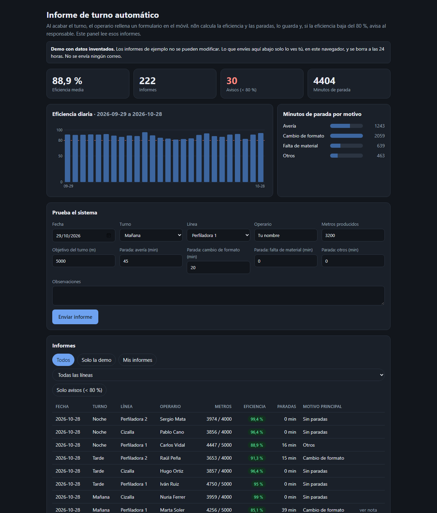
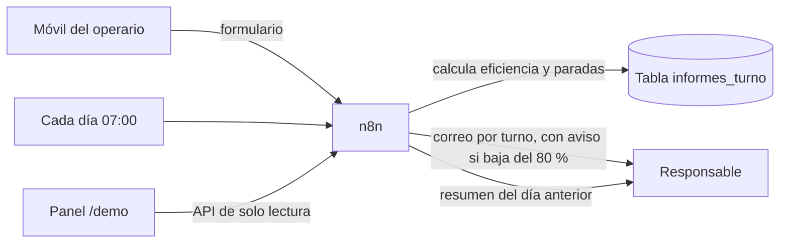
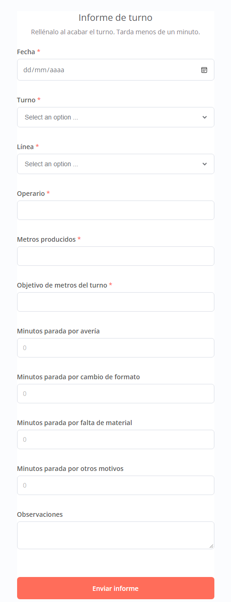

# Informe de turno automático (n8n)

Al acabar el turno, el operario rellena un formulario en el móvil. n8n calcula la eficiencia y las paradas, guarda el registro y manda un resumen, con un aviso si la eficiencia baja del 80 %. Cada mañana a las 07:00 llega el resumen del día anterior.

Demo con datos inventados de líneas de perfilado metálico.



## Qué problema resuelve

Muchas pymes industriales anotan el turno en papel o en una hoja suelta que alguien pasa a limpio al día siguiente. Cuando la eficiencia cae, el jefe de turno se entera tarde y casi nunca sabe por qué.

Con este flujo, el operario tarda menos de un minuto en rellenar el formulario desde el móvil y el responsable recibe en el momento:

- la eficiencia del turno (metros frente al objetivo),
- los minutos de parada por motivo (avería, cambio de formato, falta de material, otros),
- un aviso con el motivo principal si la eficiencia baja del 80 %.

Cada mañana a las 07:00 llega un resumen del día anterior por línea, con la eficiencia global y las 3 paradas más largas. Sin pasar nada a limpio, sin licencias y con un servidor pequeño.

## Cómo funciona





## Estado

Funciona en producción: formulario público en https://informe.kavanasystems.com, correo por turno con aviso si la eficiencia baja del 80 %, resumen diario a las 07:00 y panel de demo en https://informe.kavanasystems.com/demo/ con un mes de informes inventados.

## Demo pública

El panel `/demo/` tiene tres trámites: parte de fin de turno, vacaciones y permisos, y facturas de proveedores. Todos los visitantes ven los mismos datos de ejemplo (un mes de turnos, la plantilla de ausencias y el libro de facturas recibidas), que se regeneran cada noche con fechas relativas a hoy y no se pueden modificar. Lo que envía cada visitante sale al final de la hoja, resaltado, solo lo ve él y se borra a las 2 horas (flujo `demo-mantenimiento`, cada 15 minutos). No se manda ningún correo desde la demo: la página enseña el que se enviaría.

En facturas, cada factura pasa cinco comprobaciones (proveedor dado de alta, base + IVA = total, no duplicada, coincide con el pedido de compra y cuenta bancaria de la ficha). Si todo cuadra se contabiliza y se programa el pago en la remesa del día 10 o 25; si no, queda retenida hasta que contabilidad la aprueba o la rechaza. Sin IA: el flujo real leerá facturas de formato fijo del buzón por IMAP.

```bash
bash scripts/importar-flujos.sh   # importa todos los flujos, demo incluida
bash scripts/publicar-demo.sh     # copia el panel y siembra el mes de ejemplo
```

## Publicación

Solo salen a internet el formulario, el panel de la demo y su API. Caddy publica `/form/*`, `/form-waiting/*`, `/webhook-waiting/*`, `/demo/*` y `/webhook/demo-api/*`, manda la raíz al panel y devuelve 404 para todo lo demás, editor y resto de la API incluidos (`deploy/Caddyfile.informe`). n8n sigue escuchando solo en `127.0.0.1` y genera los enlaces públicos con `N8N_WEBHOOK_URL`.

Para añadir el bloque a Caddy sin cortar el servicio:

```bash
cat deploy/Caddyfile.informe >> /etc/caddy/Caddyfile
caddy validate --config /etc/caddy/Caddyfile --adapter caddyfile
caddy reload --config /etc/caddy/Caddyfile --adapter caddyfile --address localhost:2019
```

El formulario es abierto: cualquiera con el enlace puede enviar un informe. Si hiciera falta cerrarlo, el Form Trigger admite autenticación básica.

## Correo

Los dos flujos usan una credencial SMTP de n8n llamada `SMTP Gmail Kavana`, que se crea a mano en el editor y no está en el repo. Con Gmail: `smtp.gmail.com`, puerto 587, SSL/TLS desactivado (va por STARTTLS) y una contraseña de aplicación. Muchos proveedores de VPS, como Hetzner, bloquean la salida por los puertos 465 y 25.

- **Informe de turno**: después de guardar, envía un correo con la eficiencia, los metros frente al objetivo y las paradas por motivo. Si la eficiencia baja del 80 %, el asunto empieza por "⚠ AVISO" y el correo destaca el motivo principal. Si el correo falla, el informe queda guardado y el operario ve su confirmación igual.
- **Resumen diario de turnos**: cada día a las 07:00 (hora de Madrid) resume los informes del día anterior: por línea (turnos, metros, eficiencia, paradas y avisos), la eficiencia global y las 3 paradas más largas. Si no hubo informes, también avisa. Se puede lanzar a mano desde el editor con el nodo "Lanzar a mano".

## Flujo "Informe de turno"

Formulario → Asegurar tabla → Calcular → Guardar informe → Confirmación

- **Formulario** (`/form/informe-turno`): fecha, turno, línea, operario, metros, objetivo, minutos de parada por motivo y observaciones.
- **Asegurar tabla**: crea la tabla `informes_turno` si no existe, así el flujo funciona en una instalación nueva sin pasos a mano.
- **Calcular**: valida los datos (números no negativos, objetivo mayor que 0, paradas de 480 min como máximo) y calcula la eficiencia (metros / objetivo), las paradas totales, el motivo principal y si hay aviso (eficiencia menor del 80 %).
- **Confirmación**: el operario ve su eficiencia y sus minutos de parada.

## Flujo "RRHH · Solicitud de ausencias"

Un empleado pide vacaciones, asuntos propios o un permiso en un formulario (`/form/rrhh-ausencias`). La responsable recibe un correo con dos botones, Aprobar y Rechazar, y el empleado recibe su respuesta. Los empleados son ocho personas inventadas, y los correos de la demo salen siempre a una dirección propia (`...+nombre@gmail.com`).

Formulario → Asegurar tabla → Leer solicitudes → Calcular → ¿Válida? → Guardar → Pedir aprobación (espera) → Decisión → Actualizar → Avisar al empleado

- **Calcular** cuenta los días laborables (sin fines de semana ni festivos nacionales), comprueba el saldo de 22 días de vacaciones, que no se solape con otra solicitud suya y avisa a la responsable si coincide con alguien de su departamento. Si algo no cuadra, el empleado ve el motivo en pantalla y no se guarda nada.
- **Pedir aprobación** usa el nodo de correo en modo "enviar y esperar": la ejecución queda parada hasta que la responsable pulsa un botón. Los enlaces van firmados por n8n y Caddy los publica en `/webhook-waiting/*`. Si nadie contesta en 5 días, la solicitud pasa a "Caducada".
- **Límites de la demo**: máximo 3 solicitudes pendientes por empleado y 20 en total, para que una página pública no llene el correo ni deje ejecuciones colgadas.
- **Datos**: tabla `rrhh_solicitudes` (estado Pendiente, Aprobada, Rechazada o Caducada). El saldo se calcula con las solicitudes aprobadas y pendientes del año, sin una segunda tabla.

n8n ignora los clics que parecen de un robot (por ejemplo, `curl` sin navegador): para probar el botón desde la consola hay que enviar un `User-Agent` de navegador.

## Cargar y probar los flujos

```bash
bash scripts/importar-flujos.sh     # importa workflows/*.json, los publica y reinicia n8n
bash scripts/probar-formulario.sh   # envía 3 informes de prueba (92, 85 y 71 %)
bash scripts/probar-ausencias.sh    # 2 solicitudes rechazadas por validación y 1 válida que espera la aprobación
```

## Instalación

Requisitos: Docker con Compose, git y openssl.

```bash
git clone <este repo> && cd kavana-informe-turno
bash scripts/deploy.sh
```

`deploy.sh` crea `.env` con una clave de cifrado nueva la primera vez, arranca n8n y espera a que responda.

El editor solo escucha en `127.0.0.1:5678`. Para abrirlo desde tu equipo:

```bash
ssh -L 5678:127.0.0.1:5678 usuario@servidor
```

y luego entra en http://localhost:5678.

## Estructura

- `docker-compose.yml`: n8n con la versión fijada, un volumen persistente y logs limitados.
- `workflows/`: flujos exportados en JSON, sin credenciales.
- `scripts/`: `deploy.sh` (despliegue y actualización), `importar-flujos.sh`, `probar-formulario.sh` y `publicar-demo.sh`.
- `demo/`: panel estático de la demo.
- `deploy/Caddyfile.informe`: bloque de Caddy con las rutas públicas.
- `docs/`: capturas del README.
